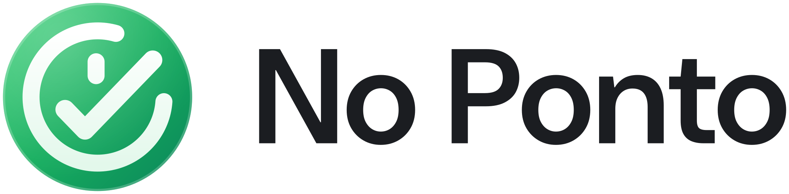
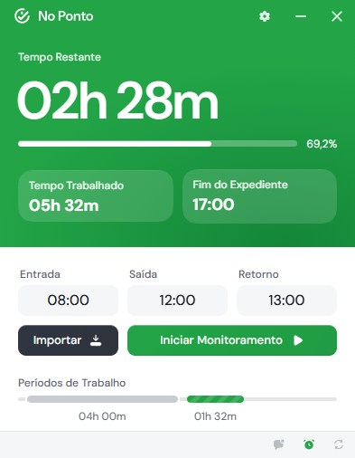
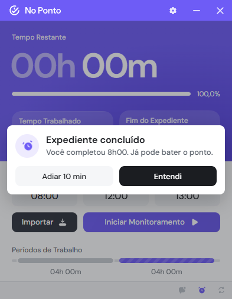
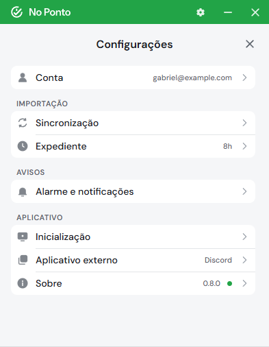
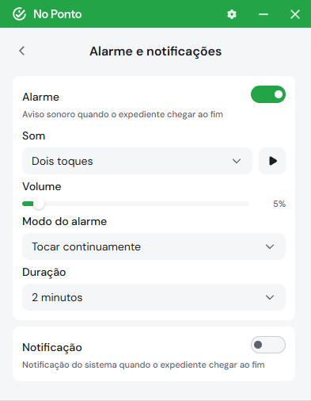

<div align="center">
  <h1>
    <picture>
      <source media="(prefers-color-scheme: dark)" srcset="branding/banner-dark.svg" />
      
    </picture>
  </h1>

  <p>
    No Ponto é um aplicativo desktop multiplataforma para acompanhar sua jornada de trabalho, importando os registros de ponto direto da API do PontoMais.<br>
  </p>

[](https://github.com/gabrielgriffo/no-ponto-desktop/releases/latest) [](LICENSE) [](https://www.rust-lang.org/)

  <p>
    <a href="https://github.com/gabrielgriffo/no-ponto-desktop/releases">
      </a>
  </p>

</div>

Importe os registros do dia com um clique e o No Ponto mostra quanto falta, quanto já foi e a que
horas você pode sair. Ele fica na bandeja acompanhando o expediente e avisa com um alarme quando a
jornada termina. Tudo roda na sua máquina, direto contra a API do PontoMais, sem servidor no meio.

## Download

Gratuito e sem cadastro. Os instaladores ficam na [página de releases](https://github.com/gabrielgriffo/no-ponto-desktop/releases/latest).

| Sistema | Arquivo | Observações |
|---|---|---|
| Windows 10 e 11, 64 bits | `No.Ponto_<versão>_x64-setup.exe` ou `No.Ponto_<versão>_x64_en-US.msi` | Sem assinatura de código; veja o passo 1 abaixo |
| Linux, 64 bits (Debian, Ubuntu e derivados) | `No.Ponto_<versão>_amd64.deb` | Instala o `gnome-keyring` como dependência |
| Linux, 64 bits (Fedora, openSUSE e derivados) | `No.Ponto-<versão>-1.x86_64.rpm` | Instala o `gnome-keyring` como dependência |
| Linux, 64 bits (qualquer distribuição) | `No.Ponto_<versão>_amd64.AppImage` | Precisa de um keyring compatível com Secret Service já instalado |

Depois de instalado, as versões novas são instaladas pela tela Sobre das configurações.

## Início rápido

1. **Instale.** No Windows, rode o instalador. Como ele não é assinado com certificado de código, o
   Windows pode mostrar "O Windows protegeu o computador" na primeira vez: escolha Mais informações
   e depois Executar assim mesmo. No Linux, instale o `.deb` ou o `.rpm` pelo gerenciador de
   pacotes, ou dê permissão de execução ao `.AppImage`.
2. **Conecte a conta.** Abra as configurações pela engrenagem, entre em Conta e informe o e-mail e a
   senha do PontoMais.
3. **Importe.** Clique em Importar na tela principal. Os registros do dia entram nos campos e o
   monitoramento começa sozinho.

Isso basta para o uso do dia a dia. Sincronização automática, alarme e inicialização com o sistema
ficam nas configurações.

## Interface

<table>
<tr><th>Tela principal</th><th>Fim do expediente</th></tr>
<tr><td></td><td></td></tr>
<tr><th>Configurações</th><th>Alarme e notificações</th></tr>
<tr><td></td><td></td></tr>
</table>

## Recursos

- **O expediente em tempo real.** Tempo restante, tempo trabalhado, horário de saída, progresso da
  jornada e a duração de cada período, atualizados a cada segundo.
- **Importação com um clique.** Os registros do dia vêm direto da sua conta do PontoMais. Também dá
  para digitar os horários à mão e acompanhar sem conta conectada.
- **Sincronização automática.** Busca os registros em segundo plano a cada 10, 15 ou 30 minutos, ou
  a cada hora, e pode importar uma vez sempre que o aplicativo abre.
- **Sincronização inteligente.** Alternativa à automática: busca com frequência até a primeira
  batida do dia e espaça as buscas depois dela, gastando menos requisições sem atrasar a detecção
  do início do expediente.
- **Intervalo previsto.** Antes de você bater a saída do intervalo, o horário de saída já considera
  o intervalo padrão configurado. Depois que a saída e o retorno são registrados, vale o intervalo
  real.
- **Cores que mostram a fase do dia.** A tela muda de cor conforme o expediente avança. Veja
  [Cores da jornada](#cores-da-jornada).
- **Alarme de fim de expediente.** Quando a jornada é completada, o No Ponto toca um som, traz a
  janela para a frente e mostra "Expediente concluído", com as opções Adiar 10 min e Entendi. São
  11 sons, com volume ajustável, para tocar uma vez ou repetir por até 2 minutos.
- **Notificação do sistema.** Opcional e independente do alarme. Se o Windows estiver bloqueando as
  notificações, a tela de configurações avisa e leva direto ao ajuste do sistema.
- **Sempre à mão na bandeja.** O ícone mostra a cor da fase atual e, ao passar o mouse, o status:
  "No Ponto: Expediente em curso", por exemplo. Fechar a janela só a esconde.
- **Inicia com o sistema.** Opcionalmente, o No Ponto abre junto com o sistema, já minimizado na
  bandeja. Também dá para fazê-lo abrir sempre minimizado.
- **Fecha sozinho em dia sem expediente.** Se ele subiu com o sistema e nenhum registro de ponto
  apareceu até o horário limite, ele se encerra: fim de semana, feriado ou folga.
- **Abre o seu aplicativo de trabalho.** Pode abrir um aplicativo escolhido por você, como o
  Discord, no início do expediente e na volta de cada intervalo. Não abre de novo se ele já estiver
  rodando.
- **Reconexão automática.** Com a opção ligada e a senha salva, o aplicativo reconecta sozinho
  quando a sessão do PontoMais expira.
- **Sem servidor no meio.** As requisições saem da sua máquina direto para o PontoMais, e senha e
  tokens ficam no cofre de credenciais do sistema. Mais em [Privacidade e armazenamento de
  dados](#privacidade-e-armazenamento-de-dados).
- **Gratuito e de código aberto.** Sem conta, sem assinatura, licença MIT.

## Cores da jornada

A cor da tela principal e do ícone da bandeja muda conforme o andamento do expediente:

| Cor | Estado | Quando aparece |
| --- | --- | --- |
|  | Em&nbsp;andamento | Expediente em curso, ainda sem atingir a jornada configurada. Também é a cor padrão com o monitoramento parado |
|  | Em&nbsp;intervalo | Saída registrada, aguardando o retorno |
|  | Hora&nbsp;extra | A jornada configurada foi atingida e o expediente continua sem a saída final |
|  | Encerrado | Saída final do dia registrada |

Enquanto nada foi registrado no dia, o ícone da bandeja aparece sem a bolinha de cor.

## Configurações

As configurações abrem pela engrenagem no topo da janela e são divididas em categorias:

| Categoria | O que tem |
|---|---|
| Conta | Conectar e desconectar a conta do PontoMais, salvar a senha e a reconexão automática |
| Sincronização | Sincronização automática e o intervalo entre buscas, importar ao iniciar, sincronização inteligente |
| Expediente | Jornada de referência (6h, 7h20, 8h, 8h48 ou personalizada) e intervalo padrão |
| Alarme e notificações | Alarme com som, volume, modo e duração; notificação do sistema |
| Inicialização | Iniciar com o sistema, iniciar minimizado, fechar sem expediente e o horário limite |
| Aplicativo externo | O aplicativo que abre no início do expediente, com um botão para testar |
| Sobre | Versão instalada e verificação de atualizações |

## Limitações conhecidas

- **O aplicativo é somente leitura.** Ele não bate ponto: o registro continua sendo feito no
  PontoMais.
- **O alarme e a notificação só funcionam com o No Ponto aberto.** Na bandeja funciona; com o
  aplicativo encerrado, não. Com o computador suspenso no horário, o aviso vem quando ele acorda.
- **A notificação depende do sistema.** Com as notificações do Windows desligadas ou o modo Não
  incomodar ativo, ela não aparece na tela. O alarme não depende disso.
- **Fechar sem Expediente só vale quando o aplicativo subiu com o sistema.** Aberto à mão, ele
  nunca se fecha sozinho. Sem sessão conectada, ele também não fecha, porque não consegue saber se
  houve registro.
- **O instalador do Windows não é assinado** com certificado de código, então o SmartScreen pode
  avisar na primeira execução.
- **No Linux, o status ao passar o mouse na bandeja** não aparece na maioria dos ambientes; a cor do
  ícone continua mudando.

## Em detalhes

<details>
<summary><strong>Como o tempo é calculado</strong></summary>

O expediente tem até quatro registros: entrada, saída para o intervalo, retorno e saída final. O
tempo trabalhado é a soma dos dois períodos, e o tempo restante é a jornada de referência menos
esse total.

Enquanto a saída para o intervalo não foi registrada, o horário de saída previsto soma o intervalo
padrão configurado. A tela principal mostra um ícone de ajuda ao lado do horário quando isso
acontece. Depois que a saída e o retorno são registrados, o cálculo passa a usar o intervalo real.

</details>

<details>
<summary><strong>Alarme</strong></summary>

O alarme toca no momento em que o expediente passa de Em andamento para Hora extra, ou seja, quando
o tempo restante chega a zero. Ele toca no máximo uma vez por dia e não toca se o monitoramento
começar depois que a jornada já foi completada.

| Opção | Valores |
|---|---|
| Som | Dois toques, Arcade, Harpa, Caixinha, Xilofone, Três toques, Batida, Eco, Console, Cristal e Kalimba |
| Volume | De 0% a 100%, com botão para testar o som |
| Modo | Tocar uma vez ou tocar continuamente |
| Duração | 5, 15 ou 30 segundos, 1 ou 2 minutos (no modo contínuo) |

Adiar 10 min para o som e toca de novo dez minutos depois. Entendi encerra o aviso do dia.

</details>

<details>
<summary><strong>Sincronização inteligente</strong></summary>

A sincronização inteligente acompanha a fase do dia em vez de buscar num intervalo fixo:

| Fase | Intervalo entre buscas |
|---|---|
| Antes da primeira batida | Começa em 5 min e cresce 2 min a cada busca sem registro, até 15 min. Das 07:00 às 10:00 fica fixo em 5 min |
| Em expediente ou em pausa | 30 min |
| Expediente encerrado | Para até o dia seguinte |

O intervalo volta a 5 min quando a janela é aberta, quando o computador volta da suspensão e
quando começam as 07:00. Cada busca tem uma variação aleatória de até 1 minuto, e uma falha de rede
não faz o intervalo crescer. Ela não funciona junto com a sincronização automática: ligar uma
desliga a outra.

</details>

<details>
<summary><strong>Fechar sem expediente</strong></summary>

Quando o No Ponto subiu com o sistema e a opção está ligada, ao chegar o horário limite (09:00,
10:00, 11:00, 12:00 ou 14:00) ele consulta o dia na hora. Se não houver nenhum registro, o
aplicativo se encerra. Se houver, ele não verifica mais até o dia seguinte. Sem sessão conectada
ou com falha na consulta, ele tenta de novo no minuto seguinte, sem fechar.

</details>

<details>
<summary><strong>Aplicativo externo</strong></summary>

O No Ponto pode abrir um aplicativo escolhido por você quando detecta o início do expediente e a
volta de cada intervalo. A detecção vem das importações automáticas, então a sincronização
automática precisa estar ligada.

No Windows, o seletor começa na pasta de atalhos do Menu Iniciar e aceita `.exe`, `.lnk`, `.bat` e
`.cmd`. No Linux, aceita `.desktop`, `.AppImage` e `.sh`. Se o aplicativo já estiver aberto, ele
não é iniciado de novo.

</details>

<details>
<summary><strong>Atualizações</strong></summary>

Ao abrir, o aplicativo consulta em silêncio as releases públicas deste repositório no GitHub e
guarda o resultado. A tela Sobre mostra a última verificação, permite verificar de novo e oferece a
instalação quando há uma versão nova; o aplicativo fecha e reabre para concluir. Os pacotes de atualização são assinados, e o aplicativo recusa qualquer pacote cuja
assinatura não confira com a chave pública embutida nele.

A consulta é uma requisição HTTPS comum, então o GitHub vê o endereço de onde ela partiu, como
veria em um navegador.

</details>

<details>
<summary><strong>Onde ficam os dados</strong></summary>

| Dado | Windows | Linux |
|---|---|---|
| Configurações | `%APPDATA%\com.gabrielgriffo.noponto\settings.json` | `~/.local/share/com.gabrielgriffo.noponto/settings.json` |
| Senha e tokens | Gerenciador de Credenciais do Windows | Keyring do sistema (Secret Service) |

</details>

<details>
<summary><strong>Executando localmente</strong></summary>

Pré-requisitos:

- [Node.js](https://nodejs.org/) 20 ou superior
- [Rust](https://www.rust-lang.org/tools/install) com a toolchain `stable`
- [Pré-requisitos do Tauri](https://v2.tauri.app/start/prerequisites/) para o sistema operacional utilizado
- No Linux: `gnome-keyring` ou outro provedor compatível com o padrão Secret Service para o armazenamento seguro das credenciais

```bash
# Instalar as dependências
npm install

# Iniciar o ambiente de desenvolvimento (Angular + Tauri)
npm run tauri dev

# Gerar a compilação de produção
npm run tauri build
```

Os arquivos de distribuição são gerados em `src-tauri/target/release/bundle/`.

Tecnologias:

- **Interface:** Angular 20 e TypeScript
- **Aplicativo desktop:** Rust e Tauri 2
- **Integração com a API:** [`reqwest`](https://crates.io/crates/reqwest)
- **Armazenamento de credenciais:** [`keyring`](https://crates.io/crates/keyring), utilizando o armazenamento seguro nativo do sistema operacional

</details>

## Privacidade e armazenamento de dados

O No Ponto é um aplicativo de execução local. Ele não utiliza servidores próprios, backends intermediários, telemetria ou mecanismos de coleta de dados.

* As requisições são enviadas **diretamente da sua máquina para a API do PontoMais**, utilizando exclusivamente as suas próprias credenciais.
* Tokens e senhas são armazenados no **keyring nativo do sistema operacional**. Essas informações não são expostas ao webview e não são gravadas em arquivos do aplicativo.
* Os dados relacionados à jornada permanecem somente na sua máquina.
* O aplicativo é **somente leitura**: ele consulta registros já existentes na sua conta e não registra, altera ou exclui nenhuma marcação de ponto.

## Aviso legal

O No Ponto é um projeto independente, pessoal e sem fins lucrativos. Ele **não possui qualquer afiliação, associação, autorização, endosso ou patrocínio da PontoMais**, de suas subsidiárias ou empresas afiliadas.

As marcas e os nomes mencionados pertencem aos seus respectivos titulares e são utilizados exclusivamente de forma descritiva, para indicar a compatibilidade do aplicativo.

O acesso à API do PontoMais é realizado utilizando exclusivamente as credenciais fornecidas pelo próprio usuário e apenas para consultar os dados da sua própria conta.

> [!WARNING]
> O uso deste aplicativo pode conflitar com os Termos de Uso da plataforma PontoMais. **A responsabilidade pelo uso é inteiramente do usuário**, incluindo eventuais medidas que o provedor possa adotar em relação à conta utilizada. Recomenda-se consultar os termos vigentes e, em caso de dúvida, a área de RH da empresa.

O software é fornecido "como está", sem garantias de qualquer natureza, nos termos da licença MIT. O No Ponto não substitui o sistema oficial de registro de ponto: os dados e valores exibidos têm caráter exclusivamente informativo, e a fonte oficial dos registros de jornada continua sendo o PontoMais.

## Licença e suporte

Distribuído sob a licença MIT; veja [LICENSE](LICENSE).

O No Ponto é gratuito e mantido por uma pessoa. Problemas e sugestões são bem-vindos nas
[issues](https://github.com/gabrielgriffo/no-ponto-desktop/issues), mas não há garantia de resposta.

MIT © [Gabriel Griffo](https://github.com/gabrielgriffo)
